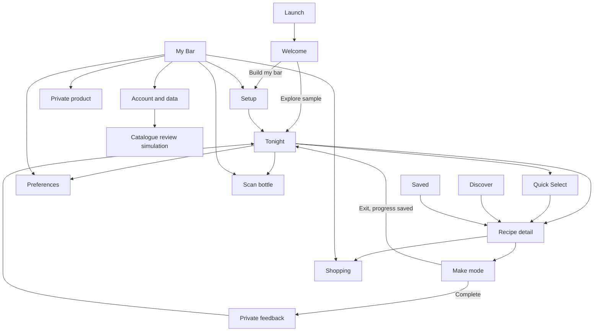

# Information architecture and journey maps

## Navigation

Primary tabs remain Tonight, My Bar, Discover and Saved. Shopping, Preferences and Account are utilities reached from My Bar and contextual links. Scan, product detail, recipe detail and setup are pushed routes. Make mode is a focused modal-like route outside tab navigation; exiting preserves progress.

## Major journeys

### First value

Welcome → Build my bar → confirm starter ingredients → answer standard and large ice → see live ready/one-away count → Tonight. Back retains local selections. Leaving before completion retains the draft snapshot. Account creation is offered only after the guest has inventory.

Sample path: Welcome → Explore sample → labelled sample Tonight. Exit switches to the untouched guest snapshot before returning home. Sample edits never mutate guest data.

### Inventory and scanning

My Bar → Scan bottle → contextual simulation boundary/permission primer → scan fixture or manual barcode → validating/lookup → recognised result. Duplicate returns “already on hand”; out-of-stock product is restored; generic overlap asks Replace generic or Keep both. Success offers inventory correction through Undo and a return to My Bar.

Unknown path: lookup failure/unknown → Add as new → name and ingredient category required → optional brand, size and local label reference → private save succeeds before sharing is offered → optional submission → processing → pending review or recoverable failure. Back preserves entered fields while the route remains mounted; saved private data survives later provider/AI failure.

### Recommendations

Tonight → temporary preference chips → Availability or Taste-led order. Availability groups ready/substitution/one-away/explore. Taste-led may cross those groups but every card keeps its status and missing evidence. Quick Select uses only eligible ready recipes; zero results asks permission to include one-away, never expands silently.

### Recipe and Make

Recipe detail → inspect availability, optional garnish, equipment, glassware, quantities and steps → choose 1–8 servings → Start making. If an unfinished session has the same count it resumes. If the count changed it returns to preflight with the new amounts and cleared timer. Make shows one step, large Previous/Next, optional timer and saved progress. Exit returns without discarding. Completion records Liked/Not for me and an optional private note without claiming recommendation learning.

### Save and shopping

Recipe or Quick Select → Save → Saved recalculates current availability. A withdrawn item remains with an unavailable explanation and remove action. Missing ingredient → add to shopping once. Shopping suggestion → inspect family/saved-recipe unlock evidence → mark owned or remove. Duplicate additions are idempotent.

### Guest conversion

Guest with value → Account → create local preview → idempotent merge into a separate account snapshot → confirmation counts and conflict count. Failure retains both source snapshots and exposes Retry. Sign out returns to the unchanged guest source. Production authentication, password recovery and cross-device backup are not represented as real.

## Back, cancellation and restoration rules

| Journey | Back/cancel | Restored state |
| --- | --- | --- |
| Setup | Back to welcome/previous route | Inventory and ice answers persist locally. |
| Scan before save | Back closes the flow | No inventory mutation; form state lasts only while mounted. |
| Scan after add | Back to My Bar | Added item persists; Undo remains until expiry unless later state invalidates it. |
| Private recovery | Back before save cancels draft | Saved private product persists before optional submission. |
| Recipe | Back returns to source tab | Save, shopping and serving preference persist; local serving stepper is route-local. |
| Make | Exit returns; gesture dismissal disabled | Version, servings, step and valid timer target persist. |
| Quick Select | Not now closes modal | History changes only after a selection is made. |
| Account import | Retry after failure | Guest and account copies remain recoverable; import ID prevents duplicate merge. |
